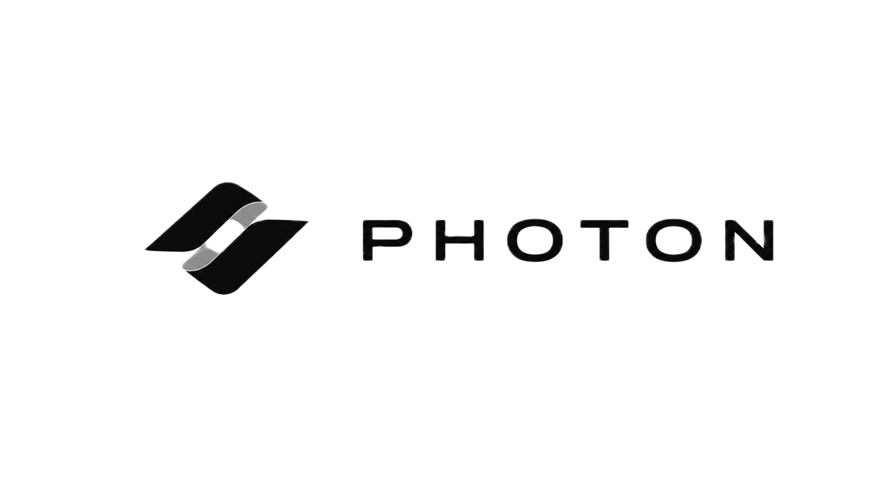

<!--
Photon — cross-platform core platform.
Keep this page focused on the public project: architecture, entry points, build, and honest limitations.
-->

<p align="center">
  
</p>

<h1 align="center">Photon</h1>

<p align="center">
  <strong>Платформенное ядро для клиентских приложений.</strong><br>
  Транспорт, идентичность, криптография, хранение данных, плагины и инструменты разработчика.
</p>

<p align="center">
  <a href="README.en.md">English</a> ·
  <a href="ARCHITECTURE.md">Архитектура</a> ·
  <a href="ROADMAP.md">Дорожная карта</a> ·
  <a href="CONTRIBUTING.md">Участие в проекте</a>
</p>

---

Photon — самостоятельная платформа на Go для построения клиентских приложений. Ядро отделено от пользовательского интерфейса и конкретного приложения; доступ к нему предоставляется через небольшой C ABI и JVM SDK. Вокруг ядра развиваются инструменты диагностики и отдельная среда исполнения плагинов.

**Photon — самостоятельная платформенная основа, а не конечное пользовательское приложение.** Ядро предоставляет переиспользуемые инфраструктурные возможности через определённые интерфейсы; пользовательские интерфейсы и прикладные сценарии строятся поверх них. Это разделение — архитектурный принцип проекта.

## Возможности

- **Ядро на Go.** Сервисы и адаптеры организованы так, чтобы отделять прикладную логику от конкретных интеграций.
- **Сетевой транспорт.** Реализованы QUIC и TCP-компоненты; текущий рабочий путь и ограничения описаны ниже и в документации.
- **Идентичность и криптография.** Компоненты идентичности, криптографические примитивы и OIDC-интеграция.
- **Хранение и обмен данными.** Локальное хранилище, события, outbox, медиа и P2P-компоненты.
- **C ABI и JVM SDK.** Внешняя граница ядра рассчитана на использование из других языков; JVM-слой поддерживает Java и Kotlin.
- **Плагины.** Отдельные процессы, IPC, манифесты и разрешения — без смешивания плагинного кода с ядром.
- **Диагностика.** Журнал ядра, Inspector Live и инструменты исследования сетевого пути, хранилища, криптографии и плагинов.

## Структура репозитория

| Компонент | Каталог | Назначение |
|---|---|---|
| Photon Core | `photon-core/` | Ядро на Go: сервисы, порты и адаптеры, транспорт, хранение и диагностика |
| C ABI и JNI | `photon-bindings/` | C-интерфейс и мост к JVM |
| JVM SDK | `photon-sdk/` | Клиентский API для Java/Kotlin |
| Среда плагинов | `photon-plugin-runtime/`, `photon-plugin-sdk/` | Исполнение плагинов и SDK для их разработки |
| Инструменты разработчика | `photon-devtools-core/`, `photon-developer-tools/` | Диагностика и Linux Desktop-клиент разработчика |
| QUIC Bridge | `photon-quic-bridge/` | Интеграционный плагин Mattermost и связанные спецификации |

## Быстрый старт

### Требования

- Go — версия зависит от модуля; для основного набора используйте Go 1.22 или новее.
- JDK 21 и Gradle — для JVM-модулей.
- C-компилятор — для модулей с cgo.
- `protoc` — для сборки `photon-developer-tools`.
- Для `photon-core/tests/transportlab/bridgesim` требуется Go 1.24 или новее; при включённом `GOTOOLCHAIN=auto` Go может загрузить нужную версию автоматически.

### Сборка и тесты

Запускайте команды из корня клона:

```sh
(cd photon-core && go build ./... && go test ./...)
(cd photon-bindings/c && go test .)
(cd photon-plugin-sdk && go test ./...)
(cd photon-plugin-runtime && go test -timeout 600s ./...)
(cd photon-sdk && gradle test)
(cd photon-devtools-core && gradle test)
(cd photon-developer-tools && gradle test)
```

Последняя команда собирает нативную библиотеку ядра и JNI. Набор зависимостей и доступность тестов могут отличаться между модулями; проверяйте требования в документации соответствующего каталога.

## Использование

- **C / нативные интеграции:** `photon-bindings/c/photon_core.h` и [README C ABI](photon-bindings/c/README.md).
- **Java и Kotlin:** [документация SDK API](photon-bindings/docs/sdk-api.md).
- **Разработка плагинов:** [руководство по плагинам](photon-plugin-runtime/docs/plugin-development.md) и примеры в `photon-plugin-runtime/examples/`.
- **Архитектура:** [ARCHITECTURE.md](ARCHITECTURE.md).
- **Версионирование модулей:** [VERSIONING.md](VERSIONING.md).

Модули Go версионируются независимо: тег включает имя каталога, например `photon-core/vX.Y.Z`. Внутренние `replace`-директивы нужны для совместной разработки в монорепозитории и не применяются потребителем опубликованного модуля.

## Текущий статус и ограничения

Photon развивается как самостоятельная платформа, но отдельные части имеют разную степень готовности. Не следует считать перечисленные ниже планы готовыми возможностями.

- **Отдельный сервер ещё не входит в этот репозиторий.** Протокол развивался вместе с первой серверной интеграцией — плагином Mattermost; для транспортных тестов используется `bridgesim`.
- **Рабочий сетевой путь пока использует QUIC.** Полная цепочка Autodial (IPv6/IPv4, QUIC/TCP и транспорт с маскировкой) ещё не подключена как единый рабочий путь; серверная часть TCP и транспорт с маскировкой не завершены.
- **Изоляция процессов плагинов поддерживается на Linux.**
- **Основная проверяемая платформа — Linux x86-64.** Поддержка Android, macOS и Windows имеет разный статус; сверяйтесь с [дорожной картой](ROADMAP.md).

Подробности и актуальные решения находятся в `photon-core/docs/`, `photon-bindings/docs/`, `photon-plugin-runtime/docs/` и в [журнале решений](DECISIONS.md). Внутренние рабочие документы вроде `CURRENT_TASK.md` предназначены прежде всего для разработки и могут меняться вместе с текущей задачей.

## Бренд и логотип

Правила написания названия, использования логотипа и оформления материалов собраны в [BRAND.md](BRAND.md). Исходный файл логотипа находится в `assets/branding/photon-logo.png`.

## Участие в проекте и безопасность

Перед отправкой pull request ознакомьтесь с [CONTRIBUTING.md](CONTRIBUTING.md) и [CLA.md](CLA.md). О потенциальных уязвимостях сообщайте приватно по инструкции в [SECURITY.md](SECURITY.md), а не в публичных issues.

## Лицензия

Photon распространяется по лицензии **GNU AGPL v3 only (`AGPL-3.0-only`)**. Полный текст — [LICENSE](LICENSE), дополнительные уведомления — [NOTICE](NOTICE), сторонние компоненты — [THIRD_PARTY_LICENSES.md](THIRD_PARTY_LICENSES.md). Краткое описание в README не заменяет текст лицензии; перед использованием изучите её условия, включая требования к распространению исходного кода и сетевому доступу к модифицированной версии.
