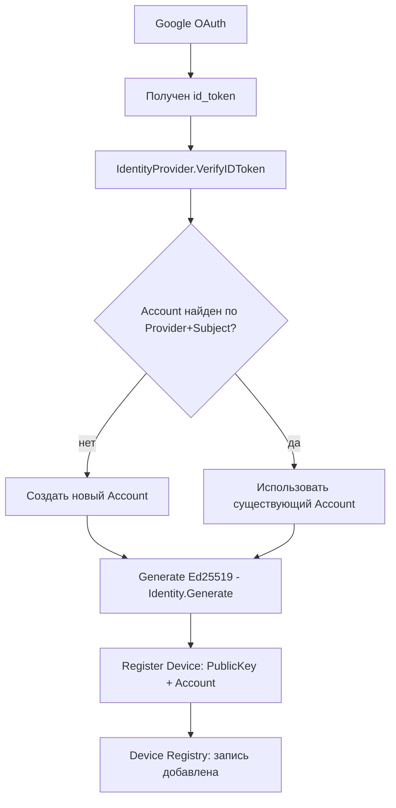
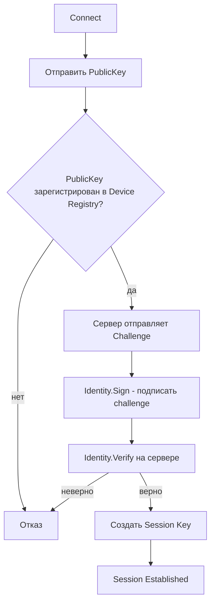
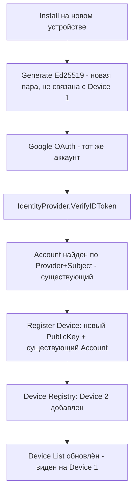
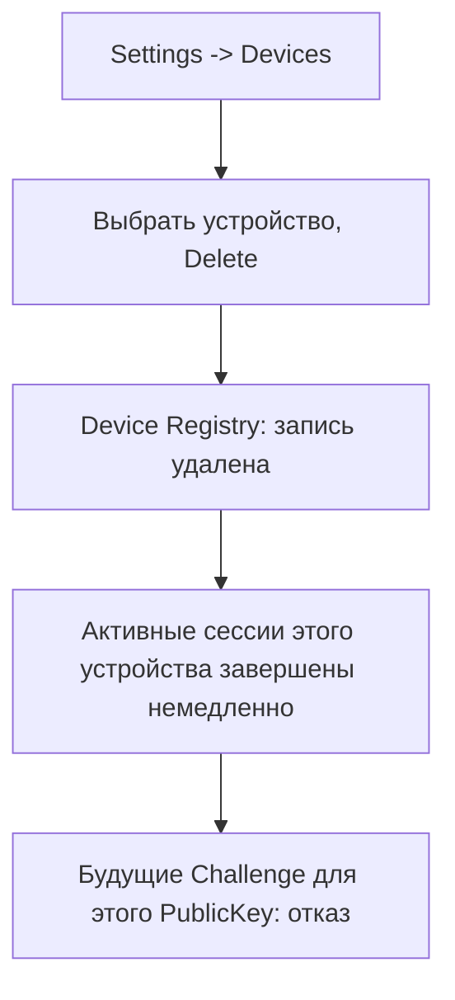
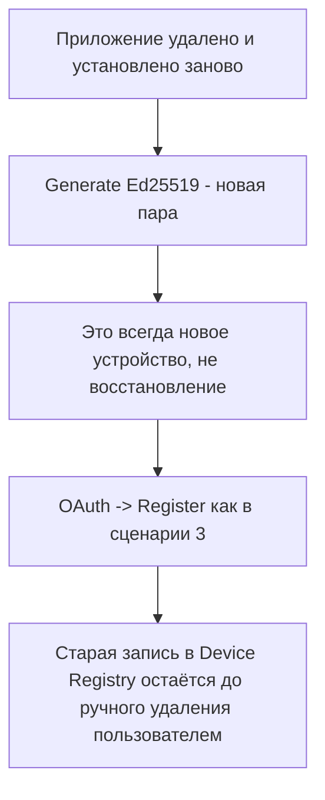

# Account & Device Flow

Сценарии для Phase 3.5 (Account & Device Management). Не архитектурное решение — см. ADR-021 (Device Trust Model), ADR-022→ADR-023 (IdentityProvider port, `Provider`+`Subject`) для решений; этот документ описывает только последовательность шагов для каждого сценария.

Участвующие компоненты:

- **IdentityProvider** (`ports/identityprovider.go`) — проверка внешнего OAuth/OIDC ID-токена. Первая реализация — `adapters/googleoidc`.
- **Identity** (`ports/identity.go`) — криптографическая личность устройства (Ed25519). Не путать с IdentityProvider — разные порты, разные концепции.
- **Account Service** (`services/account`) — связывает внешнюю OAuth-личность, Photon Account и зарегистрированные устройства. Не порт — сервис поверх `Storage`+`Identity`+`IdentityProvider`.
- **Device Registry** — часть Account Service, хранит список устройств аккаунта в `Storage`.

---

## 1. Первый вход

Устройство ещё не привязано ни к какому аккаунту.

Ключевой момент: `Account` ищется по составному ключу `(Provider, Subject)` (из `ExternalIdentity`, см. ADR-023), не по одному `Subject` и не по email. `Subject` (OIDC-идентификатор пользователя) стабилен только внутри одного `Provider` — у двух разных IdP один и тот же `Subject` не гарантированно означает одного и того же человека, поэтому `Provider` обязателен в ключе поиска. Email не используется вовсе — он может отсутствовать или измениться.

---

## 2. Обычное подключение (устройство уже зарегистрировано)

Google OAuth здесь не участвует вообще — устройство доказывает личность собственным ключом, не через IdP заново.

См. ADR-021: долговременный device-ключ используется только для этого challenge-response, не для шифрования трафика напрямую.

---

## 3. Новое устройство (уже есть Account на другом устройстве)

Явно: новая пара ключей — не восстановление старой, не перенос. Device 1 и Device 2 — независимые записи в реестре с независимыми ключами (см. ADR-021, "Переустановка приложения").

---

## 4. Удаление устройства

См. ADR-021, "Компрометация ключа": отзыв эффективен сразу, не дожидаясь истечения текущих сессий — этот сценарий идентичен и для "устройство украдено", и для "пользователь просто прибирается в списке устройств".

---

## 5. Переустановка приложения

Явное решение (ADR-021): сервер не восстанавливает и не может восстановить приватный ключ — он никогда его не видел. "Восстановление" технически невозможно, а не просто не реализовано.

---

## Что не входит в эти сценарии

- Смена email/данных профиля у IdP — не влияет на `Subject`, Account Service не должен реагировать на это как на "новый пользователь".
- Multi-IdP на одном аккаунте (например, привязать и Google, и Apple к одному Photon Account) — не рассматривается в Phase 3.5, потенциальный кандидат на будущее расширение `services/account`, не требующий изменения `IdentityProvider` port (каждый IdP — независимая реализация порта; модель данных Account Service уже сейчас хранит `(Provider, Subject)` парами благодаря ADR-023, что делает будущее связывание нескольких IdP к одному Account естественным расширением, а не переделкой ключа поиска).
